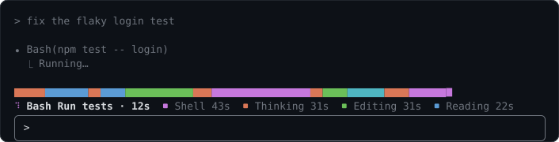
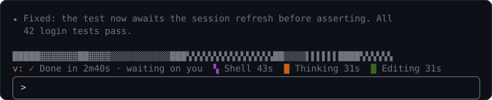
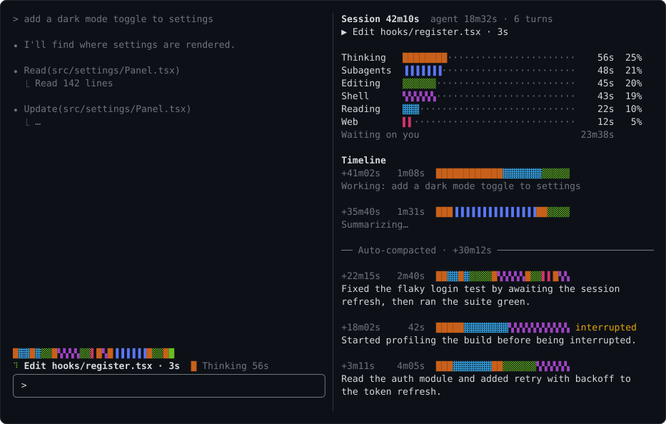
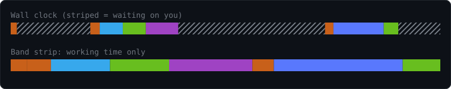

# visual-recap

A Claude Code mod that shows where the agent spends its time, live, and keeps a running timeline of what happened in the session.



**The band** sits above the prompt. The strip runs left to right through the agent's working time, colored by activity. Under it: what the agent is doing right now and for how long, then the running totals, largest first.

While the agent works, the strip is tall, its right edge pulses and a spinner turns beside the current action. When the agent stops, the strip drops to a thin line and the band says how long the turn took:





**The panel** (`/visual-recap`) docks beside the conversation in fullscreen mode, or opens above the prompt otherwise. It shows:

- Session length and how much of it the agent was working.
- Time per activity as bars, plus time spent waiting on you.
- A timeline of turns, newest first. Each turn has when it started (from session start), how long it took, a strip of that turn alone, and a one-line description of what happened. A running turn shows your prompt as **Working: …**; a finished one shows **Summarizing…** for a second or two until its description arrives; one you stopped with Esc is marked **interrupted**.
- Dividers where the conversation was compacted or cleared with `/clear`. The timeline and totals carry on past them.

The recap survives `/exit`: resume the session (`claude --resume <id>` or `/resume`) and it comes back, with the time you were away counted as waiting on you. The last 10 sessions are kept.

The images are mockups with sample data, drawn by `docs/mockups.mjs`.

## Install

At the prompt of a Claude Code terminal session:

```
/plugin install visual-recap --marketplace mascah/claude-plugins
```

Answer `y` to add the [mascah marketplace](https://github.com/mascah/claude-plugins), which lists my other plugins too, then pick a scope (user scope is first; press Enter).

From a shell:

```
claude plugin install visual-recap --marketplace mascah/claude-plugins
```

In the desktop app: click + next to the prompt box, then Plugins, Add marketplace with `mascah/claude-plugins`, then Add plugin.

## Settings

In `/config`, under visual-recap:

| Setting | Default | What it does |
| --- | --- | --- |
| Show band | on | Shows the strip and totals above the prompt. |
| Open panel at startup | off | Opens the panel when a session starts. |

## How time is counted

- Time inside a tool call goes to that tool's activity, starting from when the model begins writing the call: writing a file's contents counts as Editing, composing a long command as Shell. Parallel calls split their shared time.
- Time inside a turn with no tool being written or running counts as Thinking: the model's reasoning, its reply text, and waiting for a response to start.
- Time between turns counts as Waiting on you. The band's strip leaves it out, so a long break doesn't flatten the picture:



- The band's strip always shows the whole session. It fills from the left at a fixed scale, starting at one second per cell, so blocks already drawn stay put while the newest one grows. When the bar is full, the scale doubles and every block halves in one step. Each block gets a whole number of cells, as close to its share of the time as it can be. A turn's strip in the panel always spans its full width.
- Subagents' work counts once, as Subagents.

## Turn descriptions use an extra model call

When a turn ends, the mod asks Haiku for a one-sentence description. It sends your prompt, the actions taken (file names, commands) and the start of the agent's reply. This uses your account and costs one small call per turn. If the call fails, the entry lists the turn's first actions instead.

## Contributing

See [CONTRIBUTING.md](CONTRIBUTING.md).

## License

MIT
