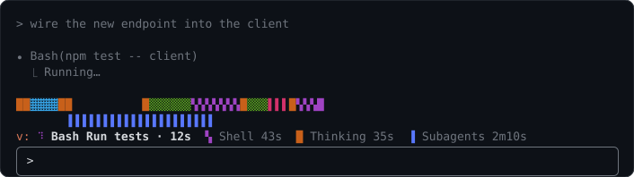

# visual-recap

A Claude Code mod that shows where the agent spends its time, live, and keeps a running timeline of what happened in the session.


**The band** sits above the prompt. The strip runs left to right through the agent's working time, each activity in its own color and glyph (█ Thinking, ▓ Reading, ▒ Editing, ▚ Shell, ▌ Web, ▐ Subagents, ▞ Asking you, ░ Other tools), so the glyph tells two activities apart where the colors look alike. The legend and the panel's bars use the same glyphs. Under it: what the agent is doing right now and for how long, then the running totals, largest first.

The band has two views:

- **Wall clock** (the default) answers "what is the agent's time going to right now". Each second goes to one activity, the main agent first: its tools, else Thinking, else Subagents when only a subagent is working.
- **Work mix** answers "what kind of work has been done". The top strip is the main agent alone; the strip under it marks when any subagent was running, on the same time scale. The totals are the main agent's, plus a Subagents total of every subagent's own run time. The main agent's own Agent tool calls are listed as **Agent calls**.



To switch views, click the legend line, or focus the band (ctrl+x tab, or a click) and press `v`. You can also run `/visual-recap view wall` or `/visual-recap view work`, even while a turn is running. Your pick lasts until the session ends. The **Band view** setting picks the view each session starts in.

While the agent works, the strip's right edge pulses and a spinner turns beside the current action. When the agent stops, the strip stays as it was, dimmed, and the band says how long the turn took. In the terminal, dimmed means drawn in your theme's dim color, so the glyphs carry the activities until the next turn starts:


**The panel** (`/visual-recap`) docks beside the conversation in fullscreen mode, or opens above the prompt otherwise. It shows:

- Session length, how much of it the main agent was working, and how long subagents worked.
- The work mix: the main agent's time per activity as bars, with percentages of its working time. Under them, a **Subagents** row with every subagent's run time added up, with no percentage, since subagents work alongside the main agent and can add up to more than the session. Then the time spent waiting on you.
- A timeline of turns, newest first. Each turn has when it started (from session start), how long it took, a strip of that turn alone, and a one-line description of what happened. A running turn shows your prompt as **Working: …**; a finished one shows **Summarizing…** for a second or two until its description arrives; one you stopped with Esc is marked **interrupted**.
- Dividers where the conversation was compacted or cleared with `/clear`. The timeline and totals carry on past them.

The recap survives `/exit`: resume the session (`claude --resume <id>` or `/resume`) and it comes back, with the time you were away counted as waiting on you. The last 10 sessions are kept.

The images are mockups with sample data, drawn by `docs/mockups.mjs`.

## Install

At the prompt of a Claude Code terminal session:

```
/plugin install visual-recap --marketplace mascah/claude-plugins
```

Answer `y` to add the [mascah marketplace](https://github.com/mascah/claude-plugins), which lists my other plugins too, then pick a scope (user scope is first; press Enter).

From a shell:

```
claude plugin install visual-recap --marketplace mascah/claude-plugins
```

In the desktop app: click + next to the prompt box, then Plugins, Add marketplace with `mascah/claude-plugins`, then Add plugin.

## Settings

In `/config`, under visual-recap:

| Setting | Default | What it does |
| --- | --- | --- |
| Show band | on | Shows the strip and totals above the prompt. |
| Open panel at startup | off | Opens the panel when a session starts. |
| Palette | default | `default` uses the mod's own colors, the same on every theme. `theme` takes them from your Claude Code theme (including its light and colorblind themes), so they change when you switch themes. Built-in themes give Reading and Asking you the same color; their glyphs tell them apart. |
| Band view | `wall` | The view the band starts each session in: `wall` (wall clock) or `work` (work mix). Any other value means `wall`. |
| Turn summaries | on | Ask Haiku for a one-sentence description of each finished turn. Off: no model call is made, and the timeline lists the turn's actions instead. |

## How time is counted

- Time inside a tool call goes to that tool's activity, starting from when the model begins writing the call: writing a file's contents counts as Editing, composing a long command as Shell. Parallel calls split their shared time. A call's time includes any permission prompt it waits on.
- Time inside a turn with no tool being written or running counts as Thinking: the model's reasoning, its reply text, and waiting for a response to start.
- Time between turns counts as Waiting on you. The band's strip leaves it out, so a long break doesn't flatten the picture:


- The band's strip always shows the whole session. It fills from the left at a fixed scale, starting at one second per cell, so blocks already drawn stay put while the newest one grows. When the bar is full, the scale doubles and every block halves in one step. Each block gets a whole number of cells, as close to its share of the time as it can be. A turn's strip in the panel always spans its full width.
- A subagent is timed from when it starts until it finishes, including a background one that outlives the turn that launched it. A background subagent keeps the band working after that turn ends.
- In the wall-clock view each second counts once. While a main-agent turn is open, a second goes to the main agent's tools, else Thinking, even if a subagent is running. Only when no turn is open and a subagent is running does it count as Subagents, not as waiting on you.
- In the work mix, and in the panel, the main agent's rows add up to its own working time. The Subagents total adds every subagent's run time on top, counting overlapping subagents each in full. Two subagents that each run for the whole of a 5-minute turn add 10 minutes.

## Turn descriptions use an extra model call

When a turn ends, the mod asks Haiku for a one-sentence description. It sends your prompt, the actions taken (file names, commands) and the start of the agent's reply. This uses your account and costs one small call per turn. If the call fails, the entry lists the turn's first actions instead. To skip the call entirely, turn off the **Turn summaries** setting: nothing is sent, and every entry lists the turn's actions.

## Contributing

See [CONTRIBUTING.md](CONTRIBUTING.md).

## License

MIT
